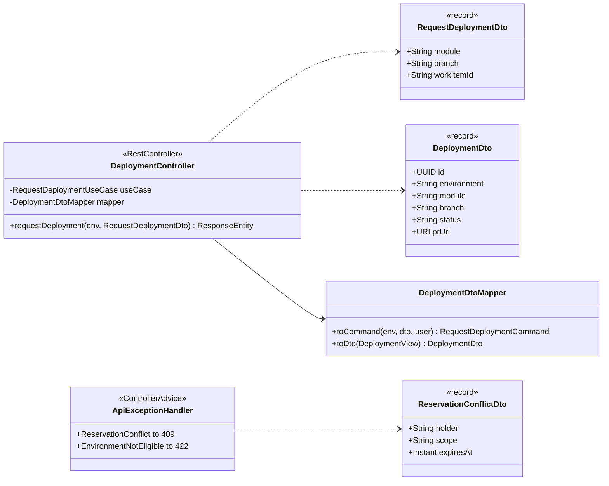

# api

`DeploymentController` (`POST /environments/{env}/deployments`) maps the OpenAPI contract to `RequestDeploymentUseCase`:

- `RequestDeploymentDto` → `RequestDeploymentCommand` (module split into
  `applicationSlug` and `moduleName`, validated against the Catalog slug pattern)
- `ReservationConflict` → `409` with `holder`, `expiresAt`
- `EnvironmentNotEligible` → `422` with the invariant id in `reason`

Tested by: contract tests generated from `contracts/deployments.openapi.yaml`; web layer
tests with the use case mocked.
