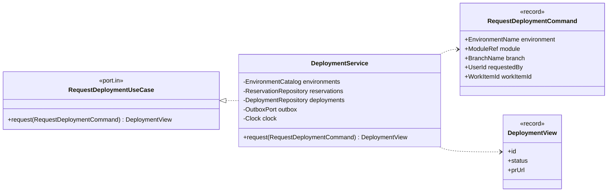
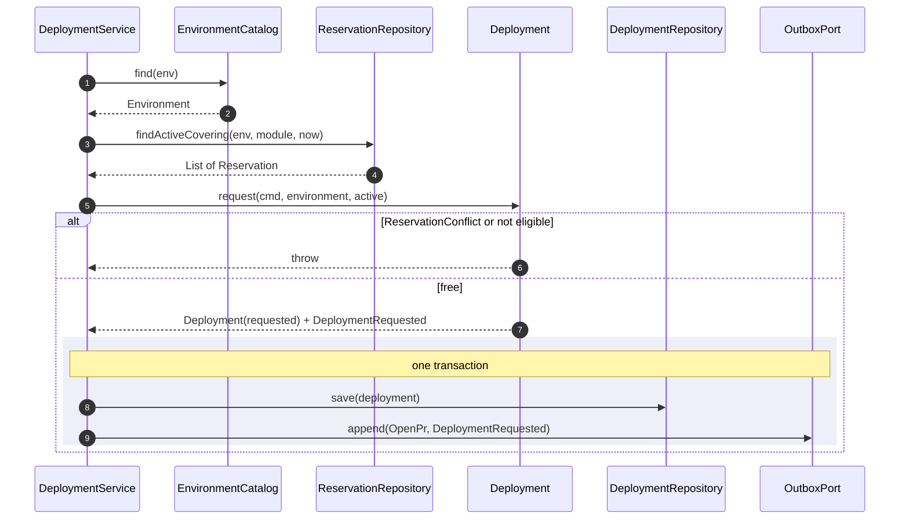

# application

`DeploymentService implements RequestDeploymentUseCase`:

1. `EnvironmentCatalog.find(env)` — step 1.1
2. `ReservationRepository.findActiveCovering(env, module, now)` — step 1.2
3. `Deployment.request(cmd, environment, active)` — steps 1.3 / 1.4
4. `DeploymentRepository.save` + `OutboxPort.append(OpenPr, DeploymentRequested)` — one transaction
5. After commit, `OutboxRelay` (infrastructure) opens the PR — step 1.5 — and publishes the event — step 1.6

Transactional boundary: steps 2–4 in one transaction; the PR call is executed after commit
through an outbox so a failed Git call never leaves a Deployment without a PR nor a PR
without a Deployment.

Tested by: use-case test with all outbound ports stubbed, one scenario per acceptance row.
