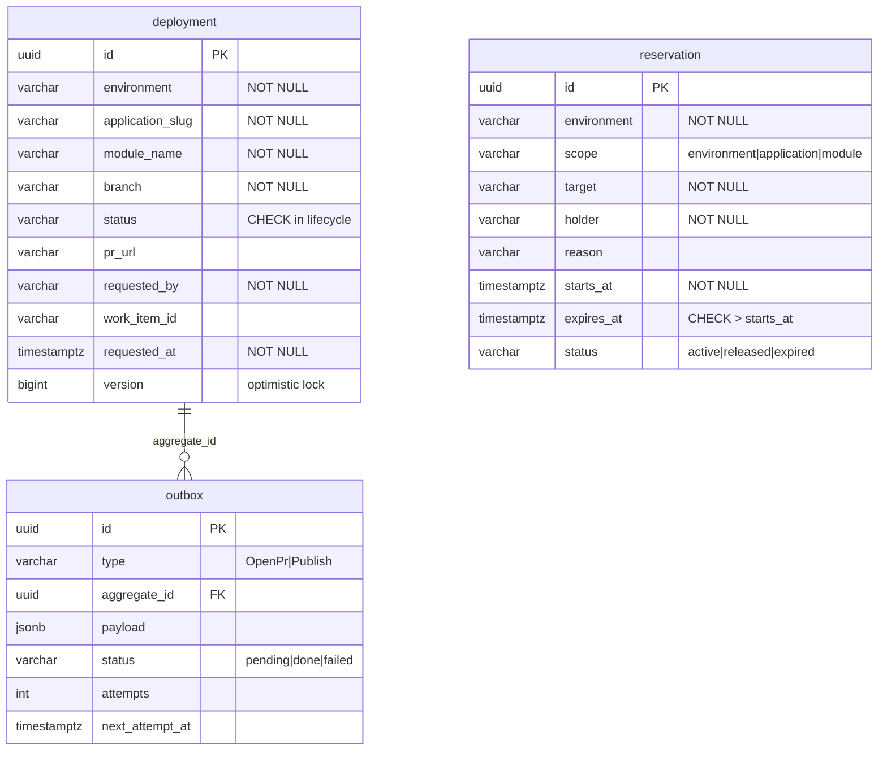

# data-model

Liquibase changelog `db/changelog/environments/0001-deployment-reservation.yaml`:
tables `deployment` and `reservation` as in the SBB data object, the `outbox` table used by the
application layer, plus

- unique partial index on `reservation (environment)` where `scope = 'environment' and
  status = 'active'` — one environment-wide Reservation at a time (INV-ENV-05)
- check constraint `expires_at > starts_at` (INV-ENV-07)
- index `deployment (environment, application_slug, module_name, requested_at desc)`

Tested by: integration tests on a real PostgreSQL (Testcontainers).
