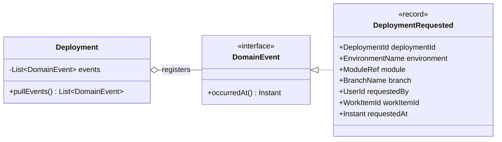

# domain.event

`DeploymentRequested(deploymentId, environment, module, branch, requestedBy, workItemId,
requestedAt)` — an immutable record emitted by `Deployment.request`. The outbound messaging
adapter maps it to the AsyncAPI message; the domain never references the bus.

The aggregate collects events; the use case pulls them after `save` and hands them to
`EventPublisher`, so the domain never knows about the bus.

Tested by: unit test asserting the event is registered on the aggregate after `request`.
