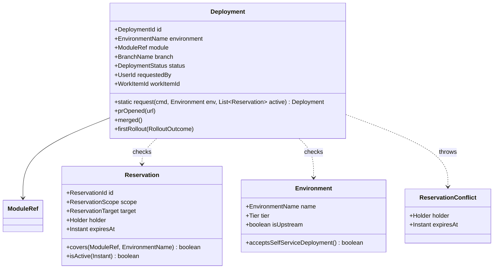
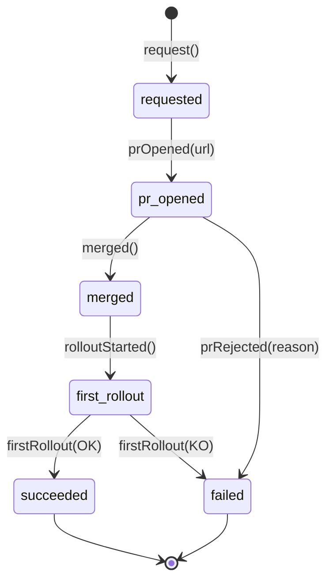

# domain

Package `com.devtoolbox.environments.domain`. No framework imports.

## Deployment lifecycle (state machine)

Transitions are methods on the aggregate; any other call throws `IllegalTransition`.
`succeeded` and `failed` are final: a new push creates a Rollout, not a new Deployment.

## Rules carried by the aggregate

- `Deployment.request` throws `ReservationConflict` when any active Reservation of another
  Holder covers (environment, module) — decision-table rows 3–5.
- `Environment.acceptsSelfServiceDeployment()` is false for Upstream environments and for
  tier `production` — rows 6–7.
- One Deployment references one Module, one branch, one Environment: enforced by the
  constructor, not by validation annotations (INV-ENV-02).

Tested by: domain unit tests, one per decision-table row.
