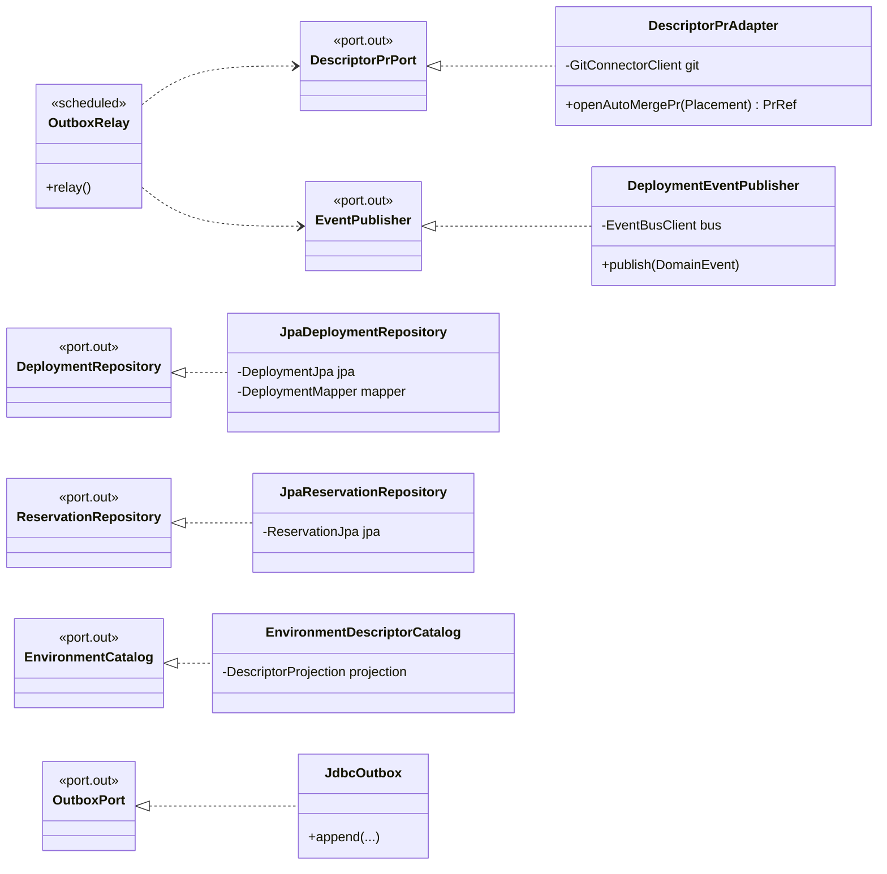
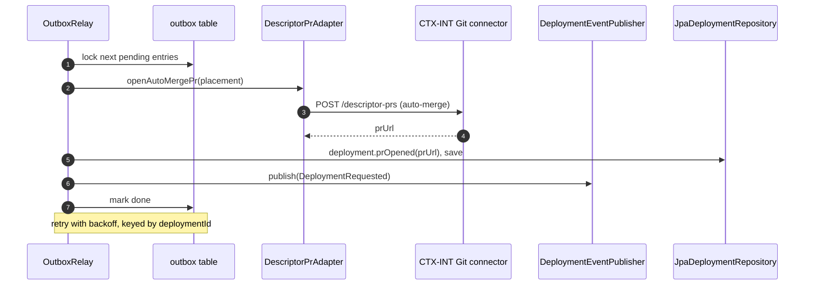

# infrastructure

| Adapter | Implements | Talks to |
|---|---|---|
| `git.DescriptorPrAdapter` | `DescriptorPrPort` | CTX-INT Git connector (REST); edits the Environment descriptor, opens a PR with auto-merge |
| `messaging.DeploymentEventPublisher` | `EventPublisher` | CTX-INT event bus, AsyncAPI contract |
| `persistence.JpaDeploymentRepository` | `DeploymentRepository` | PostgreSQL, `environments` schema |
| `persistence.JpaReservationRepository` | `ReservationRepository` | same |
| `catalog.EnvironmentDescriptorCatalog` | `EnvironmentCatalog` | descriptor projection refreshed by CMD-SYNC-ENVIRONMENTS |
| `outbox.JdbcOutbox` + `outbox.OutboxRelay` | `OutboxPort` | `outbox` table; the relay calls the PR and event adapters after commit |

No adapter holds a credential; the CTX-INT connector authenticates (INV-07, INV-ENV-03).

Tested by: integration tests with Testcontainers (PostgreSQL) and a stubbed Git connector.
