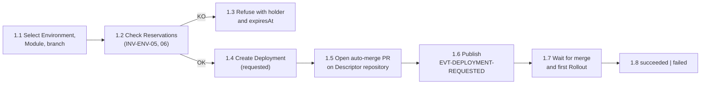

Numbered steps; the same labels are reused in the use-case test and the decision table.

## Rules

- Step 1.2 is the only place a Reservation is evaluated; it reads the Reservations that are
  `active` at the instant of the request.
- Step 1.5 goes through the CTX-INT Git connector (INV-ENV-03); the process never holds
  credentials.
- Step 1.8 is driven by Observer readings (Jenkins for the PR and Build, ArgoCD or Kubernetes
  for the Rollout), never by a timer.
