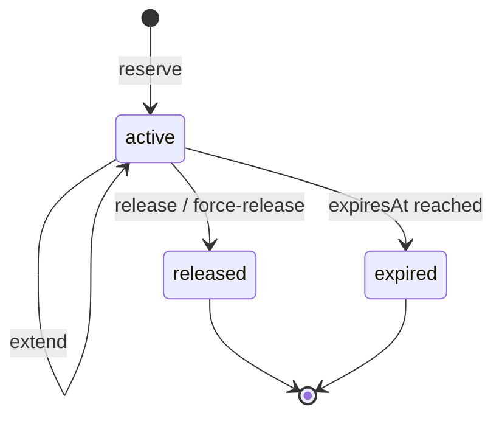

A time-boxed lock on an Environment, an Application on it, or one Module on it.
Fields: `scope` (environment | application | module), `target`, `holder`, `reason`,
`startsAt`, `expiresAt`. Every Reservation expires (INV-ENV-07).

Transitions: reserve = CMD-RESERVE-ENVIRONMENT, extend = CMD-EXTEND-RESERVATION (Holder only),
release = CMD-RELEASE-RESERVATION (Holder), force-release = CMD-FORCE-RELEASE (admin).

## Covering rule

A Reservation covers (E, M) when its scope is `environment` on E, `application` on E for
M's Application, or `module` on E for M. Two active Reservations never overlap on the same
Environment (INV-ENV-05).
