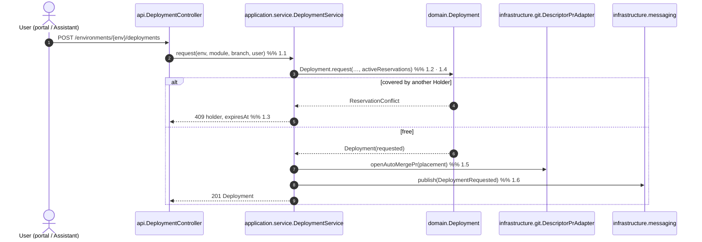

REST surface of the use case. `POST /environments/{env}/deployments` with
`{ module: "applicationSlug/moduleName", branch }`; `201` with the Deployment, `409` with the
blocking Reservation (holder, expiresAt), `422` for an Upstream or production Environment.

The step comments map to the business process steps so a contract test and the use-case
test share labels.
