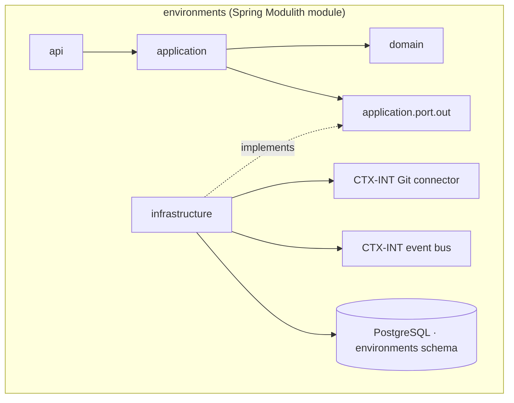

The deployable unit for CTX-ENV: one Spring Modulith module in the `devtoolbox-backend`
repository, packaged as one container image, deployed by `argocd` (Module field `deployer`).

Owns the aggregates Deployment and Reservation; reads Environment descriptors through
CTX-INT; never holds credentials (INV-07).
